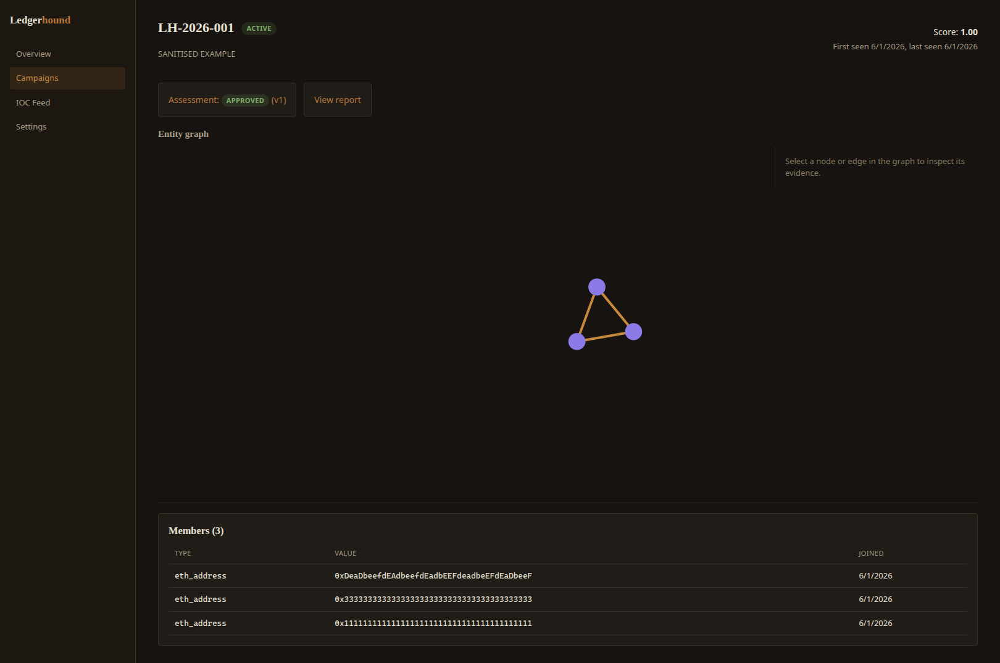
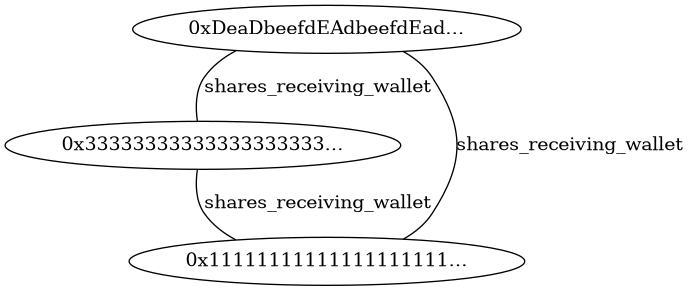

# Ledgerhound

Ledgerhound turns public crypto-scam and phishing reports into campaign
intelligence. It collects indicators (wallet addresses, domains, URLs, and
Telegram handles), checks that they are structurally valid, enriches them
from public sources, and groups indicators that share infrastructure or a
fund path into campaigns. For a campaign with an approved assessment it
writes a STIX 2.1 bundle, a MISP event, a static IOC feed, and a
Markdown and PDF report.

A person reviews every assessment before anything is published. The model
that drafts the text can only submit a fixed schema. Fields outside that
schema are rejected. Publication stays closed until that version is
approved and still matches the evidence it was approved against.

Author: Herman K. (finsecguy).

## Example: LH-2026-001

[`examples/LH-2026-001/`](examples/LH-2026-001/) is a full product set
built offline from synthetic data. Every domain is under `.example`.
Addresses are patterned test values. The report, the bundle, and the
dashboard are labelled SANITISED EXAMPLE. Nothing in that folder was
collected from a live feed, a WHOIS server, or a chain.





The folder holds `report.md`, `report.pdf`, `stix-bundle.json`,
`misp-event.json`, the `misp/` feed, the `ioc-feed/` directory, the graph
image, and the dashboard screenshot.

Regenerate it with no network calls to feeds, registries, or chains:

```bash
make example
```

That target runs `scripts/build_example.py` (the dev extra, Graphviz,
WeasyPrint's system libraries, a built `web/dist/`, and Chrome or
Playwright's Chromium). Extraction, clustering, and export are the real
code. Chain totals and the assessment drafter are local fixtures.

## Quick start

Python 3.12. A real deployment uses Postgres 16 (`docker compose up -d db`).
The test suite uses SQLite and does not need Docker. The dashboard needs
Node.js 22.

```bash
pip install -e ".[dev]"
cp .env.example .env
docker compose up -d db
lh db upgrade

lh collect --all          # network: configured feeds
lh extract                # local
lh enrich                 # network: public providers, no API key
lh cluster run            # local
lh assess draft LH-2026-001
lh assess approve LH-2026-001 --notes "Reviewed."
lh publish LH-2026-001

cd web && npm ci && npm run build && cd ..
lh serve                  # API and web/dist on :8000
```

`lh collect`, `lh enrich`, `lh trace`, and a missing ATT&CK cache all use
the network. `make example` and `pytest` do not. `lh assess draft` is the
command that needs `LLM_API_KEY`. Point `LLM_BASE_URL` at any
OpenAI-compatible server, including one you run locally.

During dashboard development, run `lh serve --reload` and `npm run dev`
in `web/` (Vite on port 5173, proxying `/api`).

```bash
pytest
ruff check ledgerhound tests
mypy --strict ledgerhound
python scripts/check_no_em_dash.py
cd web && npm test && npm run typecheck
```

## What it does

Collection stores each feed payload before parsing. Extraction keeps an
indicator only after a checksum or structural check. Enrichment records
which provider answered, and falls back when the first one fails.
Clustering links indicators with five weighted relations (shared receiving
wallet, shared cash-out path, shared certificate, shared page template,
shared registrar and nameservers) and keeps a campaign id stable when the
cluster is rebuilt. A registrar match alone cannot create a campaign.

Assessment drafting sends the model a closed evidence pack and requires a
single tool call. Business rules (real evidence refs, real ATT&CK ids, no
attribution without a high-confidence judgement, inflow copied from the
pack) are enforced in code. Export runs only for an approved, current
assessment.

Feeds today are ScamSniffer, URLhaus, and CryptoScamDB. Terms, rate
limits, and the exchange hot-wallet label set (empty until each address
has a cited public source) are in
[docs/data-sources.md](docs/data-sources.md).

The rules for extraction, enrichment, clustering, assessment, and export
are in [docs/methodology.md](docs/methodology.md). Tables and the path
from a raw report to a published file are in
[docs/architecture.md](docs/architecture.md).

## Limitations

- The configured feeds are public blocklists. A bad upstream report is
  stored as an indicator. Later stages do not silently declare it
  malicious or benign.
- Exchange hot-wallet labels ship empty. An address is added only when a
  cited public page names it. This tree does not guess wallets and does
  not query a chain to find them.
- Solana counterparty splits and TRON token transfers are partial, and
  the enrichment row says so.
- The dashboard has no authentication. It is for a database you already
  trust. Do not put `lh serve` on an open network as it stands.
- STIX has no native type for most chain addresses or for Telegram
  handles, so those indicators use documented custom types. MISP uses
  `text` for the same reason. Bitcoin has a native MISP type.
- PDF reports need WeasyPrint and its system libraries. The campaign
  graph image needs Graphviz (`dot`). Markdown still renders without
  them.
- Registration lookups use the indicator string as stored. A subdomain
  often comes back as unregistered even when the parent domain is not.

More detail is in the methodology note.

## License

MIT. Copyright Herman K. (finsecguy).
