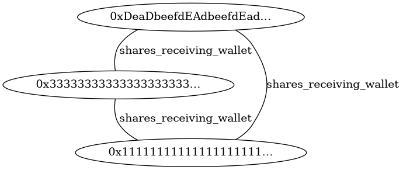

# 1. LH-2026-001: SANITISED EXAMPLE

- **Date:** 2026-06-01
- **Author:** Herman K. (finsecguy)
- **Analyst:** Herman K. (finsecguy)
- **TLP:** TLP:CLEAR
- **Overall confidence:** moderate

---

## 2. Key Judgements

- **[MODERATE]** SANITISED EXAMPLE. Three synthetic addresses show outbound transfers to the same fixture wallet in the local enrichment rows.

## 3. Summary

SANITISED EXAMPLE. This campaign is a portfolio fixture, not a real cluster. The lures use wallet-support.example, claim-drop.example, and restore-login.example.

## 4. Targeting

- **Victim profile:** No victims. The narrative is a sanitised fixture.
- **Geographies:** none specified
- **Impersonated brands:** Example Wallet

## 5. Tradecraft (MITRE ATT&CK)

No ATT&CK techniques were identified for this campaign.

## 6. Infrastructure

| Type | Value | Detail |
|---|---|---|
| eth_address | 0x1111111111111111111111111111111111111111 | chain=eth, tx_count=1, provider=sanitised-fixture |
| eth_address | 0x3333333333333333333333333333333333333333 | chain=eth, tx_count=1, provider=sanitised-fixture |
| eth_address | 0xDeaDbeefdEAdbeefdEadbEEFdeadbeEFdEaDbeeF | chain=eth, tx_count=1, provider=sanitised-fixture |

## 7. Financial Analysis

Inflow figures are the fixture totals, summed by the evidence pack. They were not read from a chain.

- **Total observed inflow:** 6000000000000000000
- **Cashout venues:** none identified
- **Sanctions exposure:** None in this fixture.

No fund-flow traces are on record for this campaign's members.

## 8. Assessment

SANITISED EXAMPLE. The addresses are linked only because the fixture gave them the same outbound counterparty.

## 9. Outlook

This fixture does not describe a live operation.

**Gaps:**

- No live enrichment was performed.
- ATT&CK techniques were left empty so the bundle would not invent a MITRE id.

## 10. Indicators of Compromise

| Type | Value (defanged) | First seen | Last seen |
|---|---|---|---|
| eth_address | 0x1111111111111111111111111111111111111111 | 2026-06-01T12:00:02+00:00 | 2026-06-01T12:00:02+00:00 |
| eth_address | 0x3333333333333333333333333333333333333333 | 2026-06-01T12:00:01+00:00 | 2026-06-01T12:00:01+00:00 |
| eth_address | 0xDeaDbeefdEAdbeefdEadbEEFdeadbeEFdEaDbeeF | 2026-06-01T12:00:00+00:00 | 2026-06-01T12:00:00+00:00 |

Machine-readable indicators: [STIX 2.1 bundle](stix-bundle.json).

## 11. Sources & Reliability

| Source | Admiralty reliability grade |
|---|---|
| sanitised-example | C |

## 12. Methodology & Limitations

- **Relations that linked this campaign:** shares_receiving_wallet
- **Fund-flow trace depth(s) used:** no traces on record
- **Providers that served this campaign's enrichment data:** sanitised-fixture
- **Partial or truncated results:**
  - None. All enrichment and trace data behind this report completed without truncation or a known provider failure.

This report was generated from Ledgerhound's evidence pack (sha256
`ea5513c27936e5205a276d695c9fbf5544e892571a47dcaf7597b25eddac4300`) for assessment version 1,
drafted by `sanitised-fixture` using prompt version
`v1`, approved by Herman K. (finsecguy)
on 2026-06-01T12:00:00+00:00.
